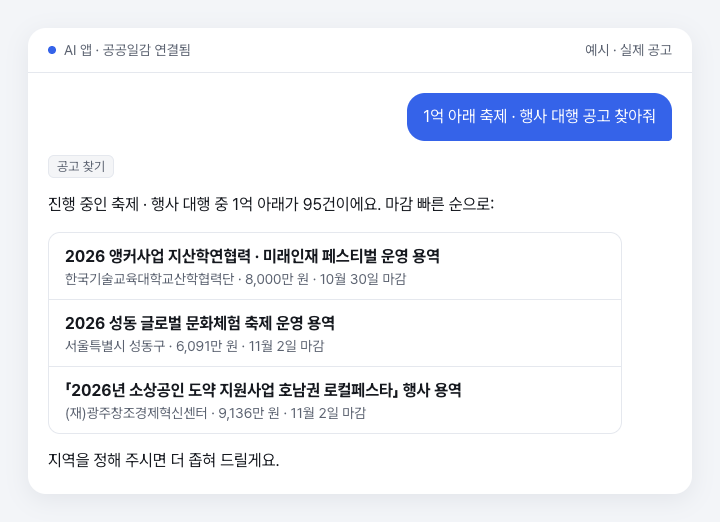
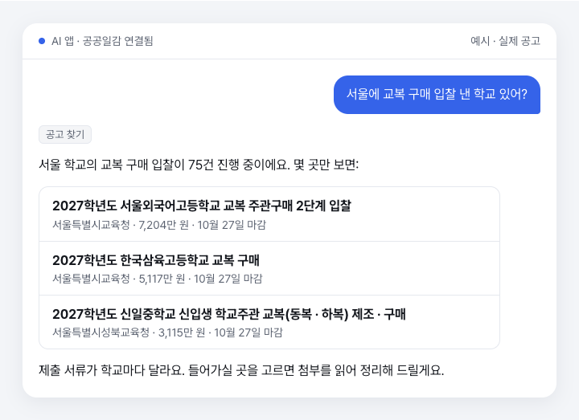
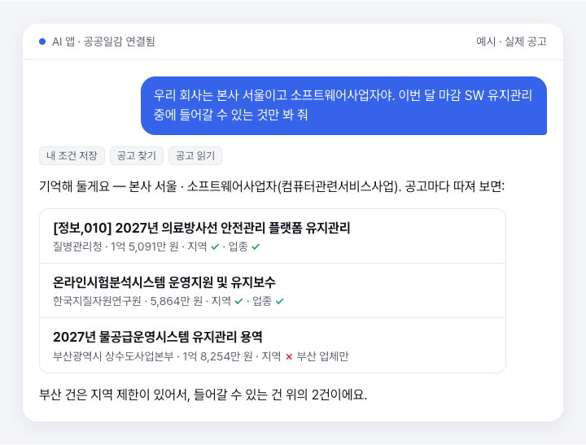
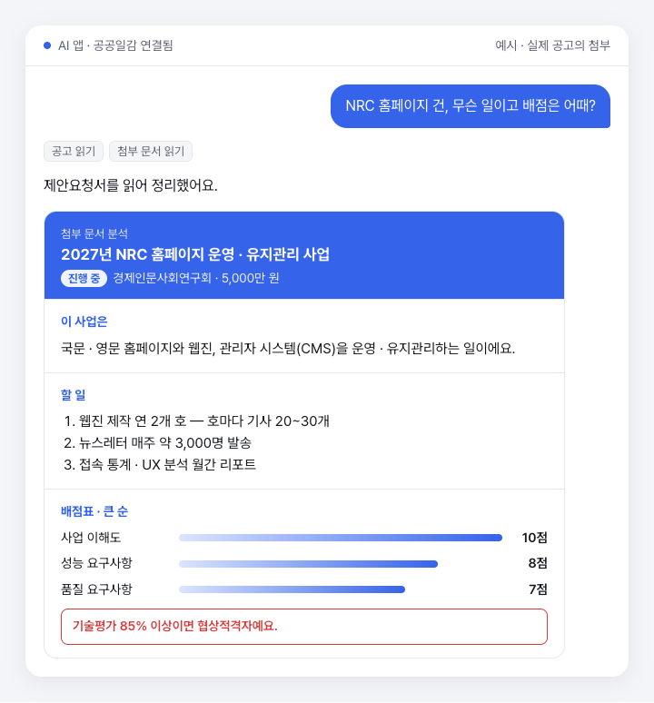
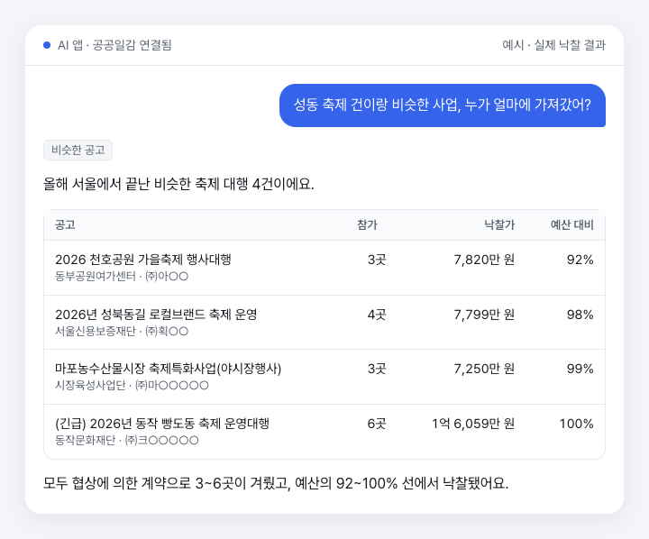
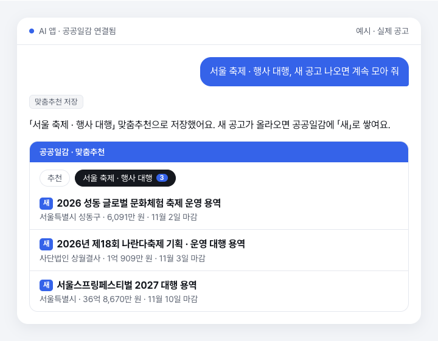

# 나라장터 · 누리장터 입찰공고 MCP (공공일감)

**우리 회사가 들어갈 수 있는 공공 입찰공고만, AI에게 말로 찾게 하세요.**

Claude · ChatGPT에 주소 하나만 넣고 로그인하면 됩니다. 설치도, API 키도, 비용도 없어요.

```
https://work-api.00data.kr/mcp
```

나라장터 · 누리장터 · 국방전자조달 · LH · K-water · 한전 · 가스공사 공고를 한 번에.
행사 · 축제, SW 개발, 영상 제작, 홍보 · 광고, 교육, 연구용역, 건축설계, 공사, 교복 같은 물품까지 분야를 가리지 않습니다.

## 내 일감만, 정확하게

### 말하면 찾습니다

찾는 일을 말하면 AI가 조건으로 바꿔 찾아요.



용역만이 아니라 교복 같은 물품, 공사도 됩니다.



### 들어갈 수 있는지 따져 줍니다

우리 회사 조건을 한 번 알려 두면, 공고마다 지역 · 업종 제한과 맞대 봅니다.



### 첨부까지 읽습니다

HWP · PDF 제안요청서에서 과업, 배점, 제출 서류를 짚어 줘요.



### 누가 얼마에 가져갔는지 봅니다

비슷한 사업의 낙찰자와 낙찰가로 경쟁과 금액을 가늠합니다.



### 새 공고를 알아서 모아 둡니다

조건을 한 번 저장하면 우리 회사 맞춤 공고 목록이 계속 채워집니다.



## 연결하기

처음 연결할 때 카카오나 구글 계정으로 공공일감에 로그인합니다.

### ChatGPT

1. ChatGPT 설정 → 앱 → 고급 설정에서 「개발자 모드」를 켭니다.
2. 「앱 만들기」를 누르고, 이름은 「공공일감」, 주소 칸에 위 서버 주소를 붙여 넣습니다.
3. 「플러그인」 탭에서 만든 앱의 「연결」 → 공공일감 로그인 → 권한을 고르고 「허용」.

> 「OAuth 콜백 데이터가 누락되었습니다」가 뜨면 플러그인 탭에서 「연결」을 한 번 더 눌러 주세요. ChatGPT 쪽에서 가끔 생기는 일이고, 대개 두 번째에는 붙어요.
> 요금제에 따라 직접 연결이 안 될 수도 있어요.

### Claude

1. Claude 설정 → 커넥터 → 「커스텀 커넥터 추가」
2. 이름은 「공공일감」, 주소 칸에 위 서버 주소를 붙여 넣습니다.
3. 「연결」 → 공공일감 로그인 → 권한을 고르고 「허용」.

웹 · 데스크톱 · 모바일 어디서 연결해도 같은 계정으로 이어집니다.

### Claude Code

```
claude mcp add --transport http gonggongilgam https://work-api.00data.kr/mcp
```

플러그인으로 설치해도 됩니다.

```
/plugin marketplace add 00data-kr/narajangteo-mcp
/plugin install gonggongilgam@00data-kr
```

처음 도구를 부를 때 `/mcp`에서 로그인하면 됩니다.

### Gemini CLI

```
gemini extensions install https://github.com/00data-kr/narajangteo-mcp
```

### Cursor · VS Code · 그 밖의 앱

원격(HTTP) MCP를 지원하는 앱이면 다 됩니다. Cursor는 `~/.cursor/mcp.json`에:

```json
{
  "mcpServers": {
    "gonggongilgam": { "url": "https://work-api.00data.kr/mcp" }
  }
}
```

VS Code는 `.vscode/mcp.json`에:

```json
{
  "servers": {
    "gonggongilgam": { "type": "http", "url": "https://work-api.00data.kr/mcp" }
  }
}
```

처음 부를 때 열리는 창에서 공공일감에 로그인하고 「허용」을 누르면 됩니다.

## 이렇게 말해 보세요

- "서울에서 하는 축제 · 행사 대행, 이번 달 마감인 것만 찾아줘"
- "SW 유지보수 사업 중에 1억 아래인 것"
- "홍보영상 제작 공고 중에 우리 회사가 들어갈 수 있는 것만"
- "정책 연구용역 중에 마감까지 2주 넘게 남은 것"
- "경기도 건축설계 용역, 5억 아래로"
- "요즘 교복 구매 입찰 낸 학교 있어?"
- "이 공고 제출 서류랑 배점표 뽑아 줘"
- "이거랑 비슷한 사업은 누가 얼마에 가져갔어?"
- "우리 회사 본사 서울이고 소프트웨어사업자야. 기억해 둬"
- "이 조건 맞춤추천으로 저장해 줘"

## 도구

| 도구 | 하는 일 | 종류 |
|---|---|---|
| `search_notices` | 조건으로 공고 찾기 · 건수 | 읽기 |
| `get_notice` | 공고 하나의 금액 · 마감 · 자격 · 첨부 목록 · 낙찰 결과 | 읽기 |
| `read_document` | 첨부 원문 전체를 표까지 살려 읽기 | 읽기 |
| `find_similar_notices` | 비슷한 공고 · 끝난 비슷한 공고의 낙찰자와 낙찰가 | 읽기 |
| `my_filters` | 내 맞춤추천 목록과 새 공고 수 | 읽기 |
| `save_filter` | 맞춤추천 만들기 · 고치기 | 저장 |
| `delete_filter` | 맞춤추천 지우기 | 지우기 |
| `my_favorites` | 즐겨찾기 폴더 · 담은 공고 · 메모 | 읽기 |
| `save_favorite` | 즐겨찾기 담기 · 폴더 옮기기 · 메모 | 저장 |
| `remove_favorite` | 즐겨찾기 빼기 | 지우기 |
| `my_profile` | 내 조건(자격 · 사용자 지침 · AI 메모리) 읽기 | 읽기 |
| `save_profile` | 내 조건 저장 | 저장 |

## 개인정보 보호

- **연결할 때 읽기 · 저장 · 지우기를 따로 켜고 끌 수 있어요.** 연결한 뒤에도 공공일감 설정의 「연결된 AI 앱」에서 언제든 바꿀 수 있습니다.
- 지우기 도구는 AI 앱이 부르기 전에 한 번 더 물어보도록 표시돼 있어요.
- **AI와 나눈 대화 내용은 공공일감으로 오지 않습니다.**
- 연결을 끊으려면 「연결된 AI 앱」에서 「연결 끊기」를 누르세요. 그 순간부터 AI가 계정에 닿지 못합니다.

## 문의

도움이 필요하거나, 있었으면 하는 기능이 있거나, 그 밖에 연락할 일이 있으면 [이슈](https://github.com/00data-kr/narajangteo-mcp/issues)에 편하게 남겨 주세요.

- 공공일감: https://work.00data.kr
- AI 앱 연결 안내: https://work.00data.kr/ai/mcp

English: [README.en.md](README.en.md)
